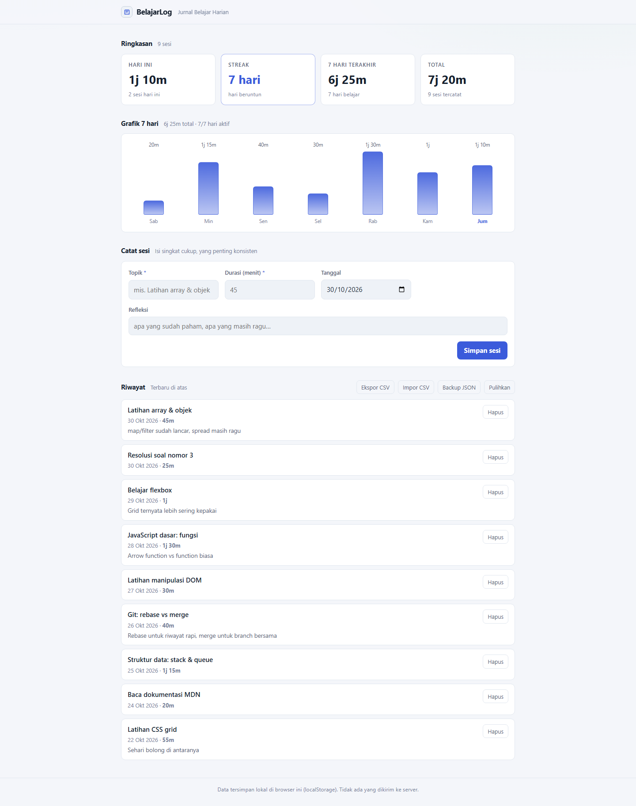

# 📚 BelajarLog: Jurnal Belajar Harian

[](https://github.com/lenathea913/BelajarLog/actions/workflows/ci.yml)
[](LICENSE)


> **English:** A free, open-source **daily learning journal** that runs fully local in your browser: no server, no account, no data leaves your machine. Log short study sessions (topic, duration, reflection) and get a daily streak, a 7-day chart, instant totals, CSV import/export and JSON backup. Built with vanilla JS + Vite, MIT licensed.

**BelajarLog** adalah jurnal belajar harian yang berjalan **100% lokal** di browser (Vite + vanilla JS, data di **localStorage**). Tidak ada server, tidak ada akun, tidak ada permintaan jaringan.

Masalahnya sederhana: orang belajar tiap hari, tapi catatannya tersebar di notes, chat, dan buku tulis, sehingga *"sebenarnya sudah berapa jam minggu ini?"* dan *"sudah berapa hari saya konsisten?"* tidak pernah terjawab.



## ✨ Fitur

- **Catat sesi belajar**: topik, durasi (menit), tanggal, dan refleksi singkat
- **Ringkasan instan**: menit hari ini, **streak hari beruntun**, total 7 hari terakhir, dan total seluruh riwayat
- **Streak harian**: masih dianggap hidup kalau hari ini belum belajar tapi kemarin sudah
- **Grafik 7 hari**: batang durasi per hari; hari tanpa sesi tetap terlihat agar celahnya ketahuan
- **Riwayat terbaru di atas**: daftar sesi dengan tanggal, durasi, dan refleksi
- **Hapus sesi** dengan konfirmasi dua langkah (tanpa dialog sistem yang membekukan halaman)
- **Ekspor & impor CSV**: kolom `Tanggal, Topik, Menit, Refleksi`; impor juga menerima alias kolom umum (`date`, `topic`, `minutes`, ...) dengan deteksi duplikat
- **Backup & pulihkan JSON**: unduh `belajarlog-backup-YYYY-MM-DD.json`; saat dipulihkan isi file **digabungkan**, data lama tidak hilang
- **Tema terang**: kontras nyaman untuk dibaca siang hari

## 🚀 Mulai cepat

**Syarat:** Node.js >= 18 ([nodejs.org](https://nodejs.org), pilih **LTS**) dan browser apa pun (Chrome / Edge / Firefox).

### Cara A (Windows)

Double-click **`start.bat`** -> dependensi terinstall otomatis (sekali saja) lalu browser terbuka di `http://localhost:5175`.

### Cara B (Manual: Windows / Mac / Linux)

```bash
git clone https://github.com/lenathea913/BelajarLog.git
cd BelajarLog
npm install     # sekali saja
npm run dev     # lalu buka http://localhost:5175
```

| Perintah | Fungsi |
| --- | --- |
| `npm run dev` | server pengembangan (port **5175**, dikunci) |
| `npm run build` | build produksi ke `dist/` |
| `npm run preview` | pratinjau hasil build |
| `start.bat` | installer + server + buka browser (Windows) |

> Port dikunci di `vite.config.js` karena `localStorage` menempel pada URL persis, jangan diubah agar data tidak terlihat "hilang".

## 🧱 Struktur proyek

```
BelajarLog/
├── index.html          # ringkasan, grafik 7 hari, form catat sesi, riwayat
├── start.bat           # launcher Windows (install + dev + buka browser)
├── vite.config.js      # port dikunci, output build
├── screenshots/        # tangkapan layar untuk README
└── src/
    ├── main.js         # render (ringkasan, streak, grafik), form, hapus, init
    ├── store.js        # state, localStorage, format durasi/tanggal, streak, deret harian
    ├── csv.js          # ekspor & impor CSV (alias kolom, deteksi duplikat)
    ├── backup.js       # backup & pulihkan file JSON (merge)
    └── style.css       # token tema & komponen visual
```

Konvensi: modul kecil satu-tanggung-jawab, komentar bahasa Indonesia, tanpa framework/pustaka runtime, Vite hanya sebagai toolchain. Tidak ada dependensi production.

## 💾 Data & privasi

- Semua data tersimpan di **localStorage browser** masing-masing.
- **Tanpa server & tanpa akun**: tidak ada telemetri, tidak ada permintaan jaringan.
- Tidak butuh file `.env` (lihat [.env.example](.env.example)).
- Pindah perangkat / pindah browser: pakai **Ekspor CSV** atau **Backup JSON**.

## 🗺️ Roadmap (belum dikerjakan)

Ide berikutnya, dikerjakan per langkah kecil, lihat [Issues](https://github.com/lenathea913/BelajarLog/issues):

- **Target mingguan**: mis. "5 jam/minggu", dengan sisa yang tersisa hari ini
- **Grafik bulanan**: heatmap menit per hari seperti kalender
- **Filter & pencarian** topik, rentang tanggal
- **Pengingat lembut** saat hari hampir habis tanpa sesi (tanpa notifikasi push)
- Mode tema gelap

## ⚠️ Keterbatasan yang perlu diketahui

- **Tidak ada sinkronisasi antar perangkat**: data menempel ke browser & origin (port) tempat kamu mengetik.
- **Backup JSON digabungkan, bukan menimpa**: sesi lama (menurut `id`) tidak terduplikasi, tapi sesi yang pernah dihapus bisa muncul lagi bila file backup lama dipulihkan.
- **Duplikat impor CSV dideteksi lewat isi** (tanggal + topik + menit + refleksi): dua sesi identik yang memang dicatat dua kali akan dianggap duplikat.
- **Tidak ada notifikasi/pengingat**: aplikasi ini pasif, kamu yang membukanya.

## 🤝 Berkontribusi

Kontribusi sangat terbuka:

1. Fork & buat branch fitur (`git checkout -b fitur/nama-fitur`)
2. Ikuti pola yang sudah ada: modul kecil, komentar Indonesia, tanpa dependensi baru tanpa diskusi dulu
3. Pastikan `npm run build` lulus
4. Buka Pull Request yang menjelaskan *perubahan* dan *mengapa*

Laporkan bug lewat [Issues](https://github.com/lenathea913/BelajarLog/issues), sertakan langkah reproduksi dan browser yang dipakai. Bug UI sangat membantu bila disertai tangkapan layar.

## 📄 Lisensi

[MIT](LICENSE): bebas dipakai, dimodifikasi, dan didistribusikan.

---

Selamat belajar! 📚
